# AbyssBeacon

**Discover. Identify. Organize.**

**A free, open-source model discovery, download, and local-library manager for Windows and ComfyUI.**

Find new checkpoints, LoRAs, workflows, and other AI resources across multiple sites. Download what you need, identify files you already have, and keep models, previews, trigger words, and storage locations organized—all from a local application.

[**Latest release**](https://github.com/Tomat0223/AbyssBeacon/releases/latest) · [**Report an issue**](https://github.com/Tomat0223/AbyssBeacon/issues) · [**Discord**](https://discord.gg/Mu7FTTBE49) · [**Email**](mailto:abyssbeacon01@gmail.com)

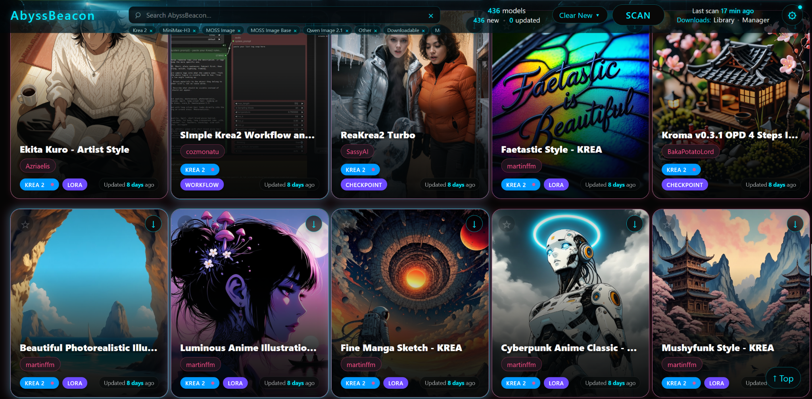

*Browse discovered models, previews, creators, and model types in one feed. Model artwork and listings come from their respective sources.*

## Why AbyssBeacon?

Finding a model is often the easy part. Remembering **which file you downloaded, what version it was, what trigger words it needs, where you put it, or whether you already have it** can be much harder.

AbyssBeacon brings three jobs together:

| Discover | Identify | Organize |
| --- | --- | --- |
| Scan several model sites from one interface | Examine models, versions, files, and previews | Search and tag your Downloaded Library |
| Find new models, updates, creators, and collections | Match existing files by SHA-256 through CivArchive | Keep review states, favorites, and installed versions |
| Search beyond your normal scan targets | Preserve original filenames and source details | Locate moved models and manage duplicates |

AbyssBeacon **does not generate images or replace ComfyUI**. It's a companion for finding, downloading, understanding, and keeping track of the resources you use.

## Discover across six model sources

| Source | Source | Source |
| --- | --- | --- |
| [CivitAI](https://civitai.com/) | [CivitAI Red](https://civitai.red/) | [Hugging Face](https://huggingface.co/) |
| [ModelScope](https://modelscope.cn/) | [TensorHub Art](https://tensorhub.art/) | [SeaArt](https://www.seaart.ai/) |

A unified feed lets you browse supported sources without repeatedly opening each website. Where the identities of mirrored listings can be verified, AbyssBeacon can group their sources and versions instead of showing separate copies.

- **New and updated model tracking**, including architecture-aware New counts and clear controls.
- Filters for **multiple architectures**, model type, source, availability, favorites, and downloaded models.
- Search within the feed; sort and review models using the information sources provide.
- **Search Sources** for custom keywords and model names outside your normal architecture scans; find models, creators, or import by URL.
- **Discovery Scan** to explore categories and tags beyond the normal watch list.
- Open creators, collections, model descriptions, source READMEs, previews, and version galleries; return to your browsing position.
- View and favorite collections, and follow individual collection items where supported.

Supported scan families include **Anima, Illustrious, Krea 2, MiniMax-H3, MOSS Image, Qwen Image 2.1, Fibo 2.0, FLUX, LTX, SDXL, Pony, WAN 2.2, and Z-Image**, including supported variants. Coverage differs by source, and new families may be added over time.

<strong>See scan configuration, model variants, and advanced search</strong>

Normal scans let you choose the sources, model families, and model types you want to include:

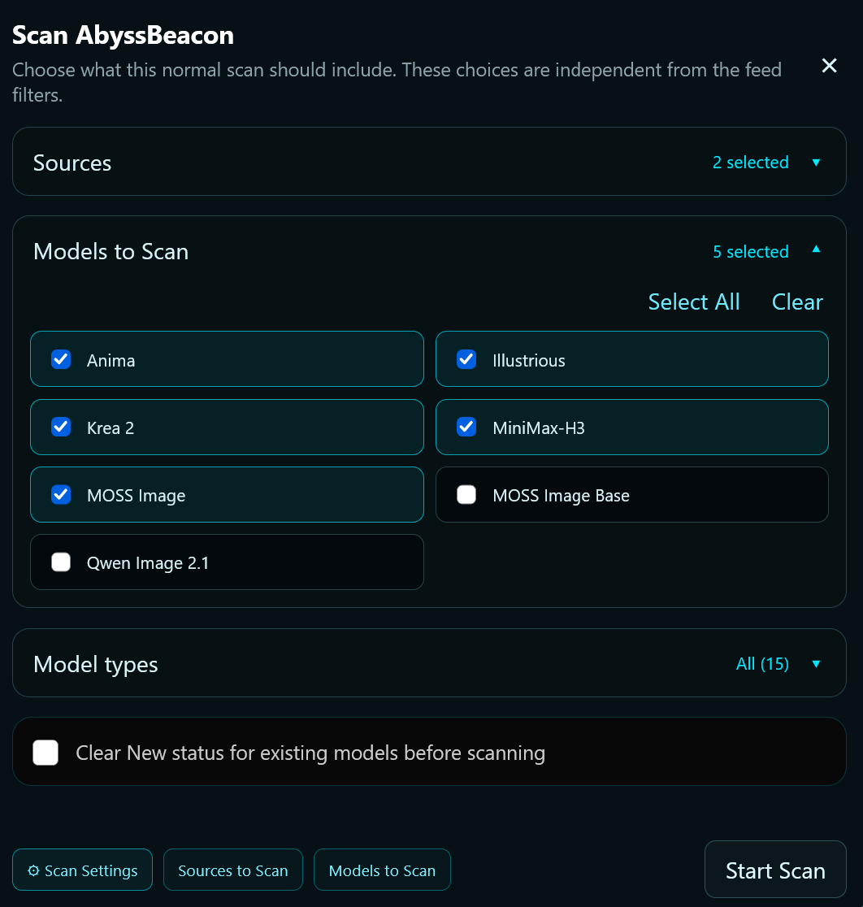

Model families with variants have their own selector, while the main settings page remains compact:

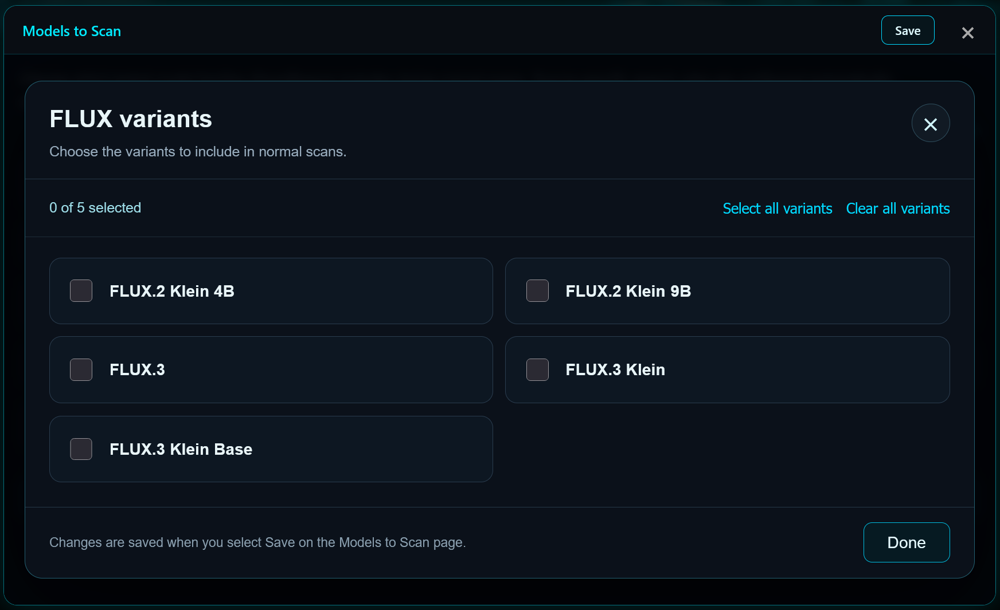

Search supported providers directly for keywords and other catalog entries outside the normal scan:

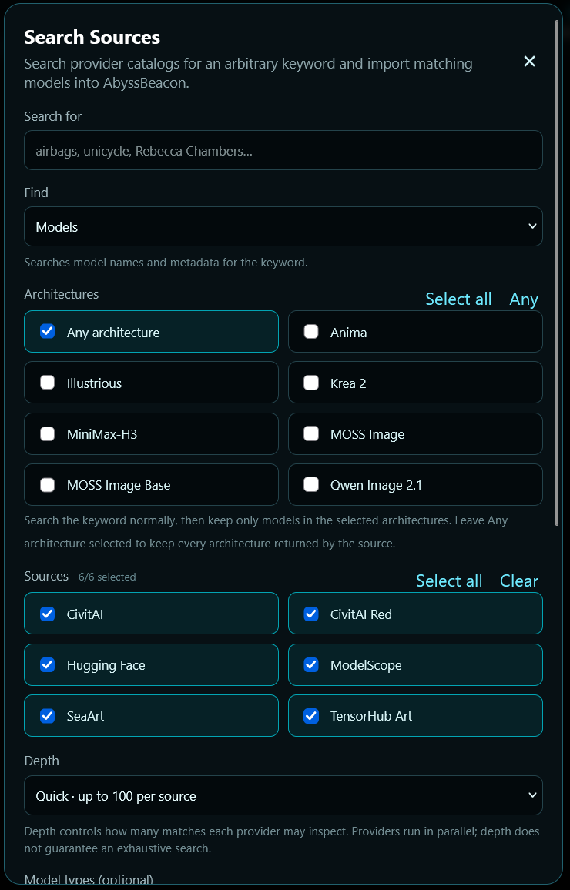

## Download with control

Choose **browser downloads** or **AbyssBeacon's managed downloader**, which can save files into your ComfyUI model directories or a custom destination.

- Inspect versions and available files before downloading: **original filenames, sizes, formats, repository paths, and quantization details** when provided.
- Distinguish primary downloads from optional or supporting files when source metadata allows.
- Choose the model classification and save location where supported; avoid automatic file renaming or overwriting.
- Use the **Download Manager** to track queued and active downloads, with progress and estimated time when available.
- Record successful managed downloads in your Downloaded Library, including their installed version and location.
- Optionally save a **preview image and model-information text file** next to the downloaded model.

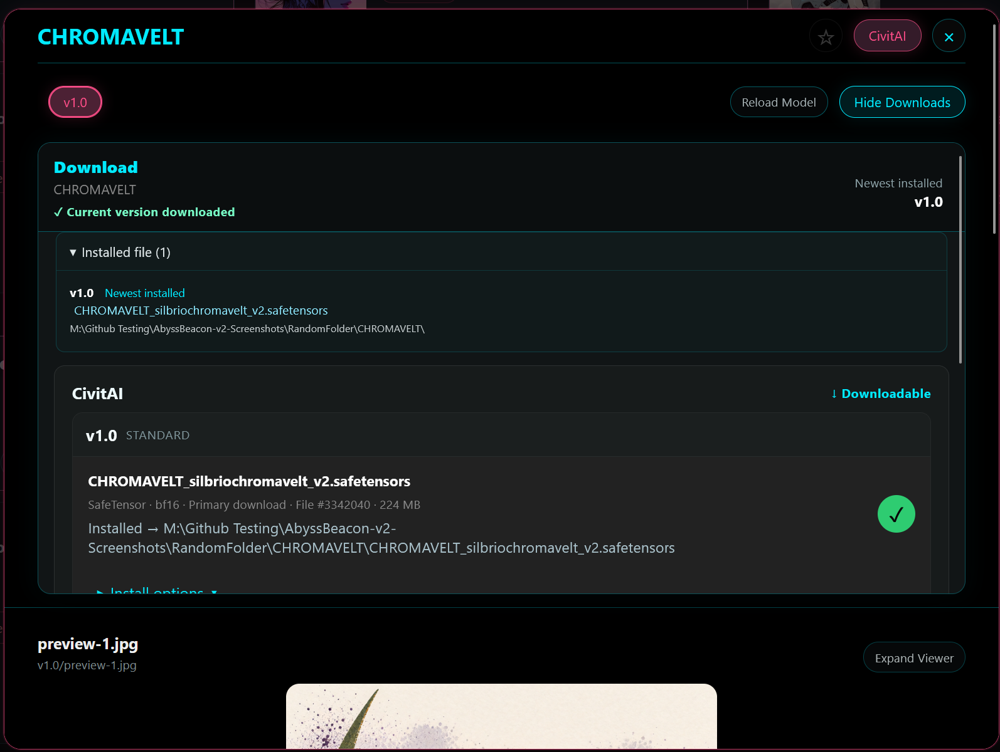

### Model information stays with the file

This is one of the main reasons AbyssBeacon exists. Instead of renaming a LoRA to include its trigger word or manually creating a separate note, you can choose to save reference information alongside the actual model.

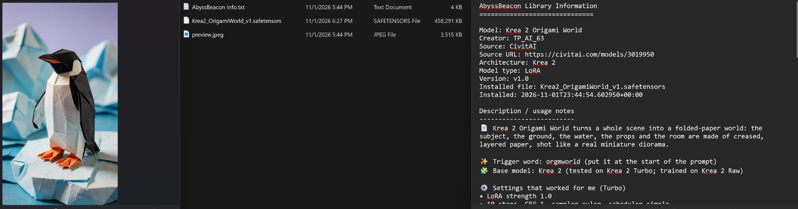

*Example of the model's original file, a saved preview, and generated notes containing its source page, creator, version, description, trigger word and usage information. The available content depends on what the original source supplies.*

### Understand access before downloading

Model sources don't all allow the same kind of download. AbyssBeacon distinguishes **downloadable files, sign-in requirements, uncertain access, paid access, and other restrictions** where source information is available. In particular, CivitAI version-level access checks can help indicate whether a download is expected to work without a connected account. Authentication hints are adjusted when the corresponding account is connected inside AbyssBeacon.

If an attempted model download returns a sign-in webpage or invalid file instead of actual model data, AbyssBeacon rejects it rather than marking the webpage as a successfully installed model. **A download indicator is not a guarantee that a third-party server will grant access.**

### Firefox Download Companion (optional)

Some sites require an authorized browser session or verification before allowing a download. AbyssBeacon includes an optional **Firefox Download Companion**, currently documented for **CivitAI Red** browser handoffs.

When a download needs this browser flow, the companion can pass the selected temporary download URL back to your **local AbyssBeacon Download Manager**. AbyssBeacon can then handle the file destination and library tracking rather than leaving it as an unrelated browser download.

The companion **does not bypass logins, purchases, or access restrictions**. It uses your authorized browser session and communicates with the local application; ordinary downloads started directly on a website remain ordinary browser downloads.

See [**Firefox companion installation, requirements, and limitations**](browser_companion/README.md). The bundled companion is for desktop Firefox, not Chrome or Edge.

## The Downloaded Library

Give the models on your computer their own searchable, organized library rather than relying only on folders and filenames.

- Search by **model, filename, creator, or your personal tags**.
- Mark models **Not tried, Keep,** or another available review state, independently of favorites.
- Add your own tags—*dragon, fantasy, Halloween, spaceship,* or whatever helps you find a file again.
- See installed versions, original filenames, source records, and recorded storage locations.
- Open containing folders directly; keep downloaded files and their identities connected.
- Review previously downloaded or deleted records through the optional download-history setting.

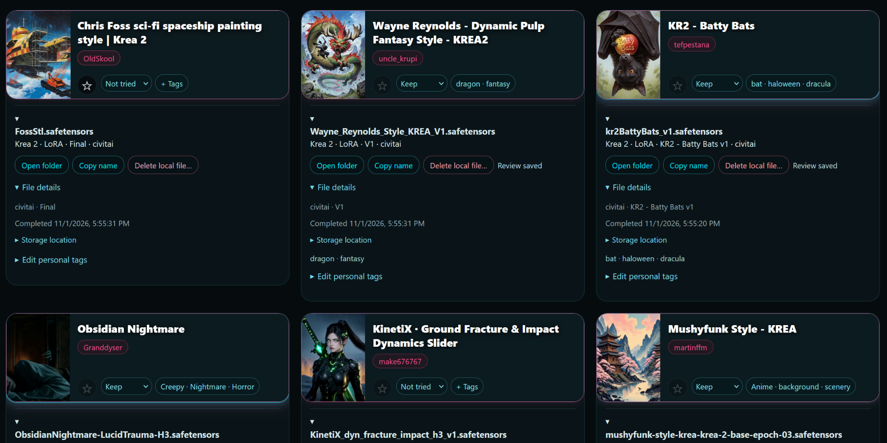

*Original filenames remain intact while tags and review states make the collection easy to search.*

## Already have hundreds of models? Import them.

You don't have to download through AbyssBeacon to use the library. Its **Add existing model files** tool can identify local files using SHA-256 fingerprints and [CivArchive](https://civarchive.com/) matches.

**You choose which folders to scan, which individual files to identify, and which results to add.** Scanning a folder does not automatically import everything it contains.

1. **Choose folders and scan.** AbyssBeacon inventories local model files without adding or moving them.
2. **Select the files you want checked.** Use individual checkboxes or **Select visible** (up to 50), then choose **Find matches for selected files**. SHA-256 fingerprints of those selected files are checked through CivArchive; the model files themselves stay on your PC.
3. **Review and confirm.** Inspect verified matches and optional destination and companion-file choices before adding them to your Downloaded Library. Files remain in place unless you explicitly choose to move them.

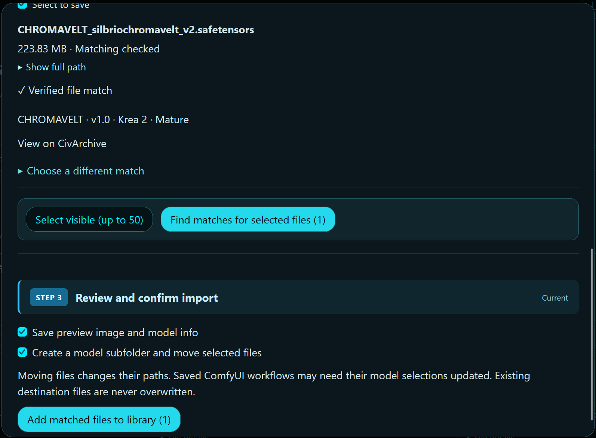

*The match is reviewed before it becomes a library entry.*

**If CivArchive finds no verified match**, you can still choose **Link by model URL**, **Link to an existing library entry**, or **Add manually**. These alternatives are useful, but they are not the same as a cryptographically verified match. Identification and available metadata depend on the sources.

<strong>See the file-selection step before SHA-256 identification</strong>

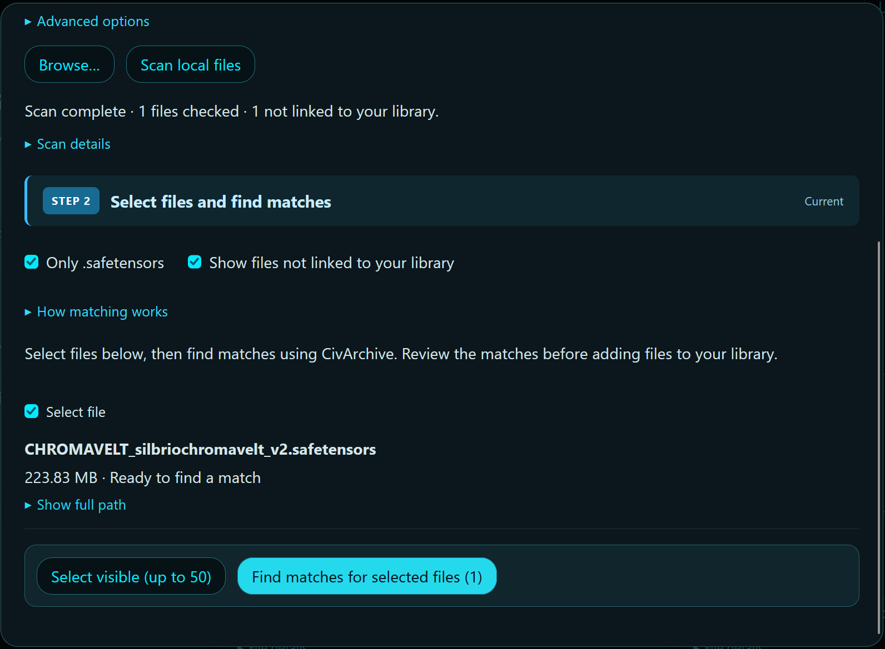

## Keep your local library healthy

AbyssBeacon includes tools for correcting file locations and identifying wasted storage:

- **Update model locations:** search chosen folders for files moved since they were linked to the library, with checks before changing recorded paths.
- **Find duplicate files:** compare actual file contents using full SHA-256, not just filenames or sizes.
- **Manage duplicate copies:** review matching paths and physical copies, then use **Open folder** or **Delete copy** beside each file.
- **Safer deletion:** confirm the exact path, verify another independent physical copy survives, and send the chosen SafeTensors copy to the Windows Recycle Bin rather than permanently deleting it. Hard links are distinguished from separate physical copies when estimating recoverable space.

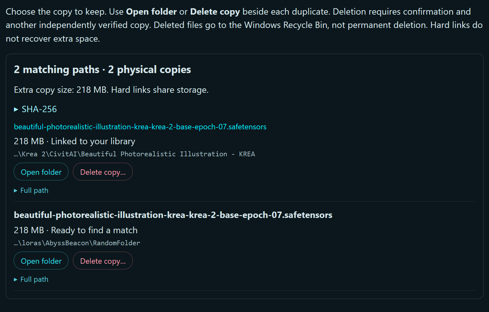

*Choose exactly which duplicate to keep. Results update after deletion, and you can run a fresh scan to verify the remaining files.*

<strong>See the moved-file location repair tool</strong>

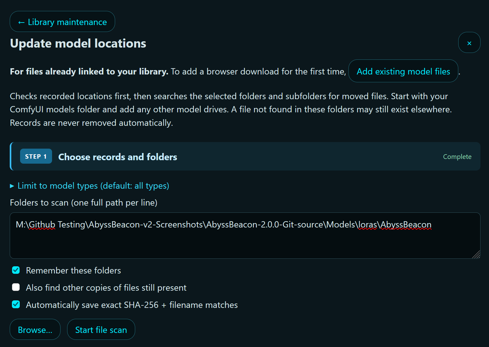

## Image previews, prompts, and workflow metadata

Open supported example images and inspect any embedded generation information they provide. Depending on the image and its metadata, AbyssBeacon can display **model references, seed, steps, CFG, sampler, scheduler, dimensions, prompts, and ComfyUI workflow data**. Copy prompts or export compatible workflow JSON where available.

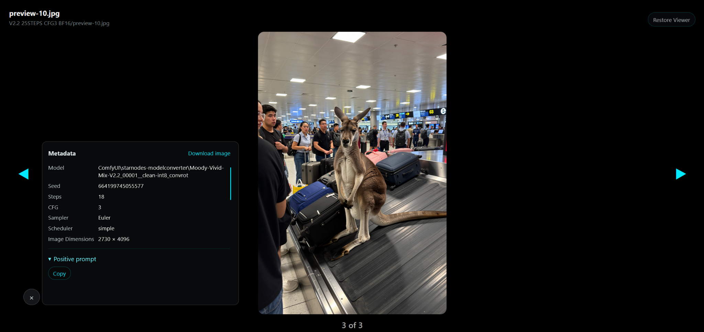

*Generation metadata varies by image. Some images have full ComfyUI workflows; others include partial information or none.*

## Getting started

### Requirements

- **Windows**, the primary tested platform.
- **Python 3** available on your system path; the included launcher creates a local virtual environment and installs the required Python packages.
- Internet access for the model sources you choose.
- **ComfyUI is optional** for discovery and library organization, but useful as a download destination.

### Fresh installation

1. Open the [**latest GitHub release**](https://github.com/Tomat0223/AbyssBeacon/releases/latest) and download its **full application/source ZIP**.
2. Extract it to its own folder.
3. Run **`AbyssBeacon.bat`**. On first launch, it creates the virtual environment and installs missing dependencies.
4. Open **`http://127.0.0.1:5000`** if your browser does not open automatically.
5. Follow the first-time guide to connect any needed source accounts, select downloads and storage preferences, and choose your scan targets.

### Updating an existing installation

Use the matching **upgrade ZIP** for your installed version when the release provides one. **Close AbyssBeacon and back up its folder, database, and settings** before replacing program files. Consult that release's upgrade instructions; do not replace your personal database or configuration with files from a fresh-install package.

### First things to try

- Select a few sources and architectures and run a normal scan.
- Open a model to explore versions, download choices, descriptions, and previews.
- Set a managed-download destination and optionally enable companion information files.
- Visit **Downloaded Library → Library maintenance → Add existing model files** to identify a model already on your computer.

## Local-first design, privacy, and limitations

AbyssBeacon is a **local Python/Flask application with a SQLite database**. It does not require an AbyssBeacon cloud account. Your library records and settings live on your computer. Scanning, checking source metadata, matching selected file fingerprints, or downloading necessarily contacts the relevant external service.

Some integrations require third-party sign-in, browser verification, or have limits imposed by their providers. Availability, download permissions, source classifications, mature-content labels, and API behavior can change. Mature content is hidden by default on new installations, but third-party classification is not infallible.

**Do not share your local database, account tokens, cookies, browser profiles, `secrets.json`, or personal configuration files** in public issues or release archives.

## Help and community

- [**GitHub Issues**](https://github.com/Tomat0223/AbyssBeacon/issues) — bug reports and reproducible problems.
- [**Discord**](https://discord.gg/Mu7FTTBE49) — questions, feedback, and discussion.
- [**Email AbyssBeacon**](mailto:abyssbeacon01@gmail.com) — support and questions.

When reporting a bug, include the source, a model or creator link where relevant, the expected and actual results, and any safe error text—but **never include credentials**.

If you'd like to support development, [voluntary tips](https://cash.app/$AbyssBeacon) are appreciated but never required.

## License and credits

AbyssBeacon is distributed under the **[GNU General Public License v3](LICENSE)**. See `LICENSE` for the full terms. It is an independent project and is **not affiliated with or endorsed by** the third-party model services it connects to. Model listings and preview artwork remain subject to their respective creators' and sources' terms.
